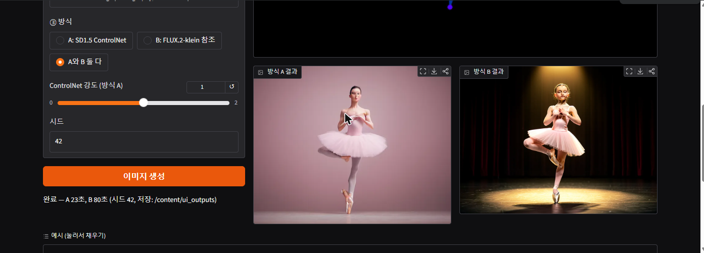
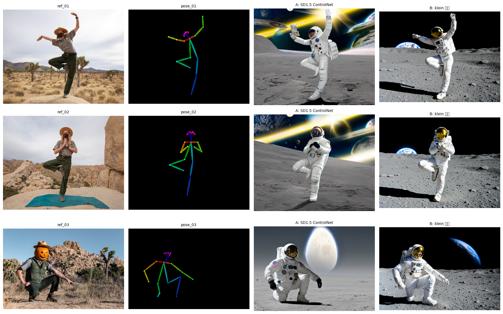

# 원하는 포즈로 이미지 만드는 도구

[](https://colab.research.google.com/github/kwkworks/pose-image-tool/blob/main/pose_tool.ipynb)

## 도구 설명
- 참조 사진에서 **OpenPose**로 사람의 관절 18개를 뽑아 색깔 뼈대 그림(`pose_XX.png`)을 만들고, 그 뼈대를 조건으로 넣어 **같은 자세의 다른 인물·장면**을 만듭니다.
- 포즈를 넣는 방식 두 가지를 나란히 비교합니다.
  - **방식 A — SD1.5 + OpenPose ControlNet**: 정식 포즈 제어. 뼈대를 ControlNet에 넣어 자세를 강제로 따르게 합니다.
  - **방식 B — FLUX.2-klein-4B + 참조 이미지(ReferenceLatent)**: 수업 실습 모델. FLUX.2에는 무료 T4에서 돌릴 수 있는 공식 포즈 ControlNet이 없어서, 뼈대 그림을 참조 이미지로 주고 "이 막대 인형과 같은 자세로"라고 지시합니다.
- 수업의 FLUX.2-klein-4B + ComfyUI Colab 노트를 출발점으로 만들었고, 무료 Colab T4 GPU에서 처음부터 끝까지 돌아갑니다.

## 사용법
1. 위 **Open in Colab** 배지를 누르거나, `pose_tool.ipynb`를 Colab에서 엽니다.
2. **[런타임 → 런타임 유형 변경 → T4 GPU]** 로 바꾼 뒤, 위에서부터 셀을 순서대로 실행합니다. (첫 실행은 모델 약 14GB 다운로드로 10분 남짓)
   - 단계 1~4: GPU 확인 → ComfyUI·GGUF 노드·OpenPose 설치 → 모델 다운로드 → ComfyUI 서버 실행
   - 단계 5~9: 도구 함수 → 참조 사진 → **OpenPose 뼈대 추출** → 생성 함수(방식 A/B) → 프롬프트
   - **단계 10: 직접 써 보기 (Gradio 화면)** ← 도구로 쓰려면 여기까지만 실행
   - 단계 11~14: 기본 결과 → 실험 ①②③
   - 단계 15: `prompts.md` 생성 + 결과 zip / 단계 16: 관찰 기록
3. **단계 10 화면에서** 포즈 사진을 올리고(또는 예시 클릭) → 프롬프트를 쓰고 → 방식(A / B / 둘 다)을 고른 뒤 **[이미지 생성]** 을 누릅니다. 셀 출력의 `gradio.live` 링크로 새 탭에서 열 수도 있습니다.



| 화면 입력 | 설명 |
|---|---|
| ① 포즈 사진 | 전신이 보이는 사람 한 명 사진. 관절을 못 찾으면 경고가 뜹니다 |
| 자세 설명 (선택) | 어려운 자세일 때 자세를 글로도 적어 뼈대가 놓친 관절을 보충합니다. 예: *lying face down, reaching back with both hands to hold her ankles* |
| ② 프롬프트 | 만들 인물·장면. 자세와 어울리는 인물일수록 덜 무너집니다(엎드린 자세에 발레리나 ✕ → 요가하는 사람 ○) |
| ③ 방식 | A: SD1.5 ControlNet(약 20초) / B: FLUX.2-klein 참조(약 75초) / 둘 다 비교 |
| ControlNet 강도 | 방식 A에만 적용. 낮으면 프롬프트가, 높으면 포즈가 이김. 어려운 자세는 1.2~1.4 |
| 시드 | 같은 시드 = 같은 결과 |
| 얼굴 표정 따라 하기 | 켜면 얼굴 점 70개(눈·눈썹·입)도 뽑아 표정의 윤곽을 옮깁니다. 얼굴이 크게 나온 사진(상반신 이상)에서 잘 되고, 방식 A(ControlNet)가 가장 잘 따릅니다. 얼굴 점이 안 잡히면 상태 줄에 경고가 뜹니다 |
| 손가락 따라 하기 | 켜면 손가락 관절도 뽑습니다. 손이 크게 나온 사진에서만 의미가 있습니다 |

**어려운 자세 대응**: 사진을 512 / 768 / 1024 세 해상도로 분석해 관절이 가장 많이 잡힌 뼈대를 자동으로 고르고, 잡힌 관절 수(18개 중 몇 개)를 보여 줍니다. 12개 미만이면 경고가 뜹니다. 엎드리기·거꾸로 서기·팔다리가 겹치는 자세는 OpenPose가 약해서, 뼈대에 빠진 부분을 모델이 흔한 자세로 채우며 결과가 기괴해질 수 있습니다.

## 폴더 구조
```
pose-image-tool/
├── README.md
├── pose_tool.ipynb        # Colab 튜토리얼 노트 (셀마다 '이 셀이 하는 일' 설명, 단계 10에 Gradio 화면)
├── prompts.md             # 사용한 프롬프트 + 생성 기록(시드·스텝·cfg·강도)
└── samples/
    ├── ref_01~03.jpg          # 참조 사진 (퍼블릭 도메인)
    ├── pose_01~03.png         # OpenPose 뼈대
    ├── output_01~03.png       # 방식 A 결과 (대표)
    ├── output_01~03_klein.png # 방식 B 결과
    ├── exp1_*, exp2_*, exp3_* # 조건 실험 결과
    ├── compare_*.png          # 비교 그림
    ├── ui_screenshot.png      # 단계 10 Gradio 화면
    └── log.json               # 생성 기록 원본
```

## 테스트 결과
모든 생성은 시드 42 고정. 방식 A = SD1.5 + ControlNet(25스텝, cfg 7, 강도 1.0), 방식 B = FLUX.2-klein-4B(4스텝, cfg 4.0). 무료 Colab T4 기준 A 장당 약 10~23초, B 약 75초.



| 포즈 | 참조 자세 | 프롬프트 | 방식 A (ControlNet) | 방식 B (klein 참조) |
|---|---|---|---|---|
| 01 | 양팔을 벌리고 한쪽 다리를 든 자세 | astronaut | 팔·다리 위치 일치 | 팔·다리 위치 일치, 배경·조명 더 사실적 |
| 02 | 나무 자세(한 발로 서기) | astronaut | 일치 | 일치 |
| 03 | 쪼그려 앉아 팔을 벌린 자세 | astronaut | 앉은 자세는 맞지만 **한쪽 무릎을 땅에 댐** | 양발 쪼그림 + 팔 뻗음까지 비슷 |

**실험 ① 같은 포즈 + 다른 프롬프트** (`compare_exp1_same_pose.png`)
- 우주비행사·발레리나·기사 모두 자세는 그대로 유지됐다.
- A는 발레리나의 극장 무대 배경을 무시하고 분홍 단색 배경을 그렸고, 오른쪽 아래에 워터마크 같은 글자 흔적이 생겼다. B는 무대 조명·성·역광까지 반영했다. (A는 CLIP 77토큰, B는 언어모델 Qwen3 텍스트 인코더)

**실험 ② 같은 프롬프트(knight) + 다른 포즈** (`compare_exp2_same_prompt.png`)
- 세 포즈 모두 자세가 바뀌어 따라왔다. 쪼그려 앉기에서 A는 시키지 않은 칼을 쥐여 주었다. B는 세 장 모두 투구 없는 얼굴로 그렸다(프롬프트에 투구를 안 적음).

**실험 ③ ControlNet 강도** (`compare_exp3_strength.png`)
- 0.3: 포즈 무시 / 0.6: 다리만 따라옴 / 1.0: 일치 / 1.4: 1.0과 거의 같음 → 이 포즈에서는 1.0 근처가 경계.

자세한 관찰은 노트 마지막 셀 **[단계 16] 관찰 기록**에 있습니다.

## 한계
- **OpenPose가 못 잡는 자세는 살릴 수 없습니다.** 처음 3번 포즈로 쓴 요가 '다운독'(머리가 아래, 얼굴 가림)은 관절이 하나도 잡히지 않아 검은 뼈대가 나왔고, 두 방식 모두 그냥 서 있는 사람을 그렸습니다. 그래서 쪼그려 앉은 사진으로 바꿨습니다. 결과보다 뼈대 그림을 먼저 확인해야 합니다.
- 기본 설정(위 실험)에서는 손가락·얼굴 관절을 추출하지 않아(`include_hand=False`, `include_face=False`) 손 모양과 표정은 통제되지 않습니다. 단계 10 화면의 **"얼굴 표정 따라 하기"·"손가락 따라 하기"** 체크박스를 켜면 추출하며, 표정은 얼굴이 크게 나온 사진에서 잘 옮겨졌습니다. 다만 표정은 눈·눈썹·입의 **윤곽**만 옮겨지고 미세한 감정까지는 어렵습니다. 전신 사진처럼 얼굴이 작으면 얼굴 점이 잡히지 않고(상태 줄에 "얼굴 점 없음" 표시), 손가락은 손이 크게 나온 사진에서만 의미가 있습니다.
- 방식 B는 정식 포즈 제어가 아니라 "막대 인형과 같은 자세로"라는 지시로 유도하는 방식이라, 자세가 복잡해지면 보장되지 않습니다.
- 프롬프트에 적지 않은 소품(칼)·복장(투구)은 모델이 마음대로 채웁니다.
- 방식 B는 무료 T4에서 장당 약 75초로 A보다 3~7배 느립니다.

## 출처와 라이선스
- 참조 사진: Joshua Tree National Park (NPS), Wikimedia Commons, **Public domain**
  - [Park Ranger in Joshua Tree Yoga Pose (50695377468)](https://commons.wikimedia.org/wiki/File:Park_Ranger_in_Joshua_Tree_Yoga_Pose_(50695377468).jpg)
  - [Park Ranger in Joshua Tree Yoga Pose (50696134541)](https://commons.wikimedia.org/wiki/File:Park_Ranger_in_Joshua_Tree_Yoga_Pose_(50696134541).jpg)
  - [Ranger Jack O'Lantern (52464647862)](https://commons.wikimedia.org/wiki/File:Ranger_Jack_O%27Lantern_(52464647862).jpg)
- 모델: FLUX.2-klein-4B (Apache 2.0, GGUF 양자화본: unsloth), Stable Diffusion 1.5 (CreativeML OpenRAIL-M), ControlNet 1.1 OpenPose (OpenRAIL), OpenPose 추출기 (lllyasviel/Annotators, controlnet_aux)
- 도구: ComfyUI, ComfyUI-GGUF
